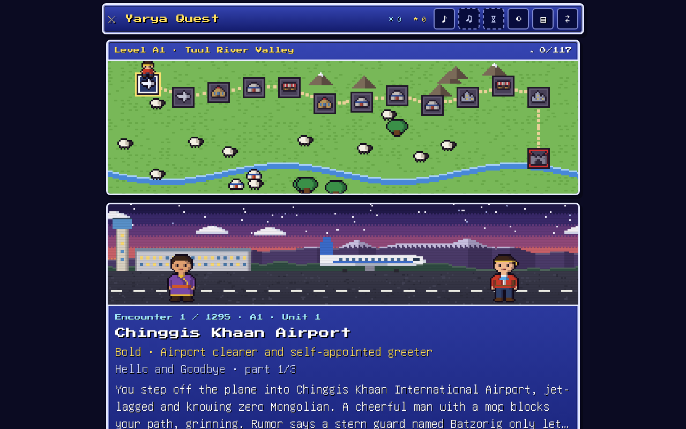
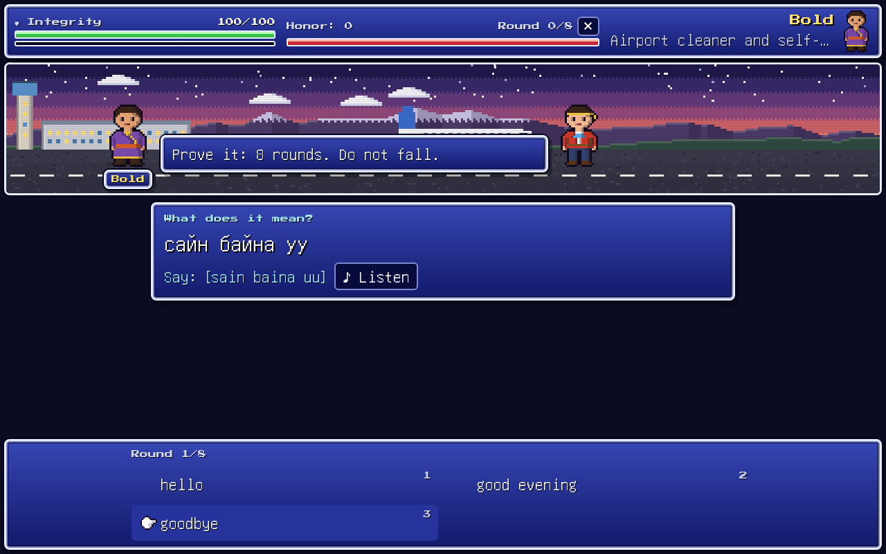
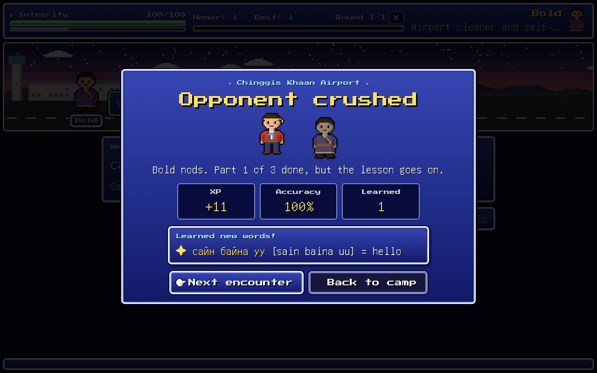

# Language Quest

English ⇄ Mongolian language learning: one lesson database, two games on top of it.

- **Lessons** (`course/index.html`): bite-size lessons with words, sentences, grammar tips, fill-in-the-blanks and
  dialogues, plus streaks, XP and "practice your mistakes".
- **Language Quest** (`course/quest/index.html`): a 16-bit JRPG survival adventure. You land in Mongolia (or, for
  Mongolian speakers, in London) knowing nothing. Every encounter teaches you a few words, then tests you in a duel.
  At the end of each level a boss is waiting: BATZORIG the Khan's Guard, or Sir Edmund the King's Guard.

Both games work in both directions: English speakers learning Mongolian, and Mongolian speakers learning English.
They share one learner profile, so words you learn in one game count in the other.

In the adventure's camp, choose **Change look** to preview Traveler, Nomad, Scholar, or Ranger.
Select **Use this look** to save your character for battles and the world map. Your choice is remembered
in this browser and shared by both language directions.





## Play

Download the repository and double-click `course/index.html` (lessons) or `course/quest/index.html` (quest).
There's no install, no server and no internet needed; progress is saved in your browser.

It can also be hosted as a static site (e.g. GitHub Pages, serving the `course/` folder).

### Deploy on Vercel

Import this repository and keep the Root Directory at the repository root (`.`).
The included `vercel.json` selects the **Other** framework preset, skips installation and building,
and serves the already-generated `course/` directory. The Python scripts are offline content-generation
tools; they are not a Python web server and do not need an entrypoint or credentials to deploy the game.

If the project was previously detected as Python, deploy the latest commit from `main` so Vercel reads
the new configuration. Lessons are available at `/` and the adventure game at `/quest/`.

## What's inside

| Path | What |
|---|---|
| `course/lessons/*.json` | 1,391 lessons (A1 to C1): vocabulary, sentences, grammar, fill-in-the-blanks, dialogues, culture notes |
| `course/outline.json` | Course plan: units and lessons |
| `course/db/` | The database the games read: `content.js` (35k items) and `story.js` (quest story lines). See `course/db/README.md` |
| `course/shared/` | Shared learner model (`progress.js`: mastery, spaced repetition, XP, streaks) and exercise builders (`exercises.js`) |
| `course/index.html` | Lessons game |
| `course/quest/` | Quest game: `campaign.js` (encounters), `pixel.js` (all sprites and scenes, drawn in code), `chip.js` (chiptune sound), `gallery.html` (every sprite and scene on one page) |
| `course/audit.md` | Latest quality audit of a sample of lessons |
| `course_tests/` | Tests: Python (pytest) and Node (jsdom, Playwright screenshots) |
| `*.py` (root) | The pipeline that wrote the course with Claude on AWS Bedrock |
| `docs/` | The briefs given to the AI developer runs that built the games |

## How the course was made

All content was written by Claude (Anthropic) on AWS Bedrock, in stages:

1. `make_course.py`: Claude Opus plans the units, then writes each lesson; a second pass checks it as an editor.
2. `fix_course.py`: Claude Opus acts as a native Mongolian and English editor and fixes the remaining mistakes.
3. `audit_course.py`: Opus spot-checks a sample of lessons (latest: 8.5/10, about 0.1 major mistakes per lesson).
4. `make_story.py`: Opus writes each encounter's story, for both campaigns.
5. `build_db.py`: turns the lesson files and stories into `course/db/` (run it after changing lessons).

The games themselves were built by Claude Opus working as a developer in a sandbox (`bedrock_dev.py`, using
[Daytona](https://www.daytona.io/)), from the briefs in `docs/`.

The content is AI-written and machine-checked; it has not yet been fully reviewed by a native speaker.
Corrections are welcome.

### Running the pipeline

Needs Python 3.11+ and AWS credentials with Bedrock access to Claude:

```
pip install -r requirements.txt
```

Put your keys in a `keys.txt` next to the scripts (`AWS_ACCESS_KEY_ID=...`, `AWS_SECRET_ACCESS_KEY=...`,
`AWS_SESSION_TOKEN=...`, `AWS_REGION=us-west-2`; `DAYTONA_API_KEY=...` for `bedrock_dev.py`). `keys.txt` is in
`.gitignore`; never commit it.

### Tests

```
python build_db.py
cd course_tests && npm install && cd ..
python -m pytest course_tests -q
```

`build_db.py` also writes `course/db/content.json`, which the tests read; it isn't committed because it duplicates
`content.js`. The screenshot tests need `pip install playwright` and `python -m playwright install chromium`.

The optional character-skin browser checks use Node Playwright: install it with
`npm install --no-save --prefix course_tests playwright`, then run `node --test course_tests/skins_test.js`.
Install its browser with `course_tests/node_modules/.bin/playwright install chromium`, or set
`BROWSER_EXECUTABLE` to the path of an existing Chrome installation.

## Credits

- Fonts: Press Start 2P (SIL OFL) and a subset of GNU Unifont (SIL OFL); licenses in `course/quest/assets/`.
- Concept: the original quest prototype, "quest_mgl".
